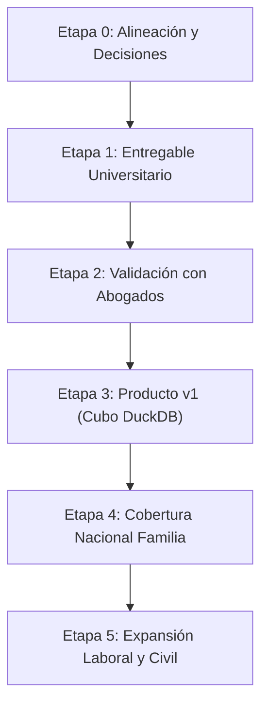

# Inteligencia Judicial y Eficiencia Procesal (PJUD Chile)
### Plataforma de Business Intelligence y Analytics para Estudios de Abogados

---

## Contexto Estratégico del Proyecto

Este proyecto desarrolla una **plataforma integral de inteligencia de negocios (BI) y analítica judicial** basada en los microdatos públicos del **Poder Judicial de Chile (PJUD)**, focalizada en las **Audiencias Realizadas** de la jurisdicción de la **Corte de Apelaciones de Valparaíso (Código 30)** durante un decenio completo (**2015–2025**).

- **Cliente Objetivo y Segmentación de Mercado:**
  - **Estudios de Familia (Pequeños y Medianos):** Reducción de incertidumbre para clientes y optimización de tarifas planas mediante tarificación ajustada al riesgo de continuaciones.
  - **Departamentos Legales Corporativos y Aseguradoras:** Provisionamiento de contingencias y benchmarking de duración procesal (crucial al expandir a Laboral y Civil).
  - **Clínicas Jurídicas, CAJ, Defensoría de la Niñez y Mejor Niñez:** Planificación y distribución balanceada de carteras de causas masivas por bloque horario y tribunal.
  - **Legaltechs Establecidas (ej. Lemontech CaseTracking, Lexgo):** Integración del motor predictivo y cubo analítico vía API o licenciamiento de datos.
- **Propuesta de Valor Cuantificable:**
  - **Predictibilidad de Plazos y SLAs:** Predecir tiempos de espera de agendamiento y madurez procesal por juzgado, sustituyendo la intuición subjetiva por evidencia cuantitativa empírica.
  - **Estrategia de Pricing y Costeo:** Medir la tasa de litigiosidad y riesgo de continuaciones de juicio para tarificar honorarios (tarifa plana vs recargo por audiencia).
  - **Capacidad de Sala y Time-Tracking:** Analizar la duración real en sala y la saturación semanal y horaria para evitar colisiones de comparecencia.
  - **Productividad Telemática:** Cuantificar el ahorro en traslados y viáticos mediante la comparecencia remota (Ley 21.226 / 21.394).
- **Estado Actual (MVP Certificado en Familia):** Producto Mínimo Viable (MVP) 100% completado en la competencia de **Familia**, sentando la arquitectura y metodología para su escalamiento a materias Laboral, Penal y Civil, así como a nivel nacional (cobertura ~7× mayor).

---

## Arquitectura de la Plataforma Web (Streamlit)

La plataforma cuenta con una interfaz web interactiva multi-página desacoplada y orientada a roles ejecutivos y técnicos:

```text
src/App/
├── Inicio.py                     # Portada institucional, navegación y alcance del MVP
└── pages/
    ├── 1.- Ingesta de Datos.py    # Monitoreo de extracción REST desde la API judicial
    ├── 2.- Notebook ETL.py       # Réplica técnica ejecutable del cuaderno de 7 fases (código y lints)
    ├── 3.- Informe ETL.py        # Informe interactivo ejecutivo de hallazgos forenses y decisiones procesales
    ├── 4.- Dashboard BI.py       # Tablero analítico ejecutivo interactivo con 5 vistas de negocio (Plotly)
    └── 5.- EDA y Hallazgos.py    # Análisis exploratorio interactivo de la espera (P1) y hallazgos procesales
```

### Módulos Principales de la Aplicación:
1. **`Inicio`**: Visión general, contexto institucional del Poder Judicial y hoja de ruta de escalamiento multi-materia.
2. **`1.- Ingesta de Datos`**: Monitoreo y ejecución de llamadas hacia la API estadística del PJUD, descarga de lotes anuales y consolidación inicial.
3. **`2.- Notebook ETL`**: Publicación interactiva fiel del cuaderno [`01 ETL_audienciasparquet.ipynb`](notebooks/01%20ETL_audienciasparquet.ipynb), detallando cada una de las 7 fases del pipeline de datos con sus bloques de código, visualizaciones de nulos y verificación de tipos.
4. **`3.- Informe ETL`**: Resumen ejecutivo interactivo estructurado en torno a los **hallazgos forenses y decisiones de negocio** (rescate del lote 2023, causa única `ID_CAUSA_RIT`, eliminación legal de `FECHA_FIRMA`, imputación de audiencias inmediatas y tratamiento de outliers).
5. **`4.- Dashboard BI`**: Tablero directivo para estudios de abogados con filtros globales dinámicos (años, macro-materias, juzgados y modalidad telemática) y 5 pestañas analíticas:
   * **Tablero 1: SLAs y Predictibilidad de Plazos:** Benchmark de los 15 juzgados por días hábiles de espera y segmentación de cuellos de botella.
   * **Tablero 2: Litigiosidad y Riesgo de Costos:** Tasa de continuaciones, distribución de audiencias por causa y diseño de estructuras tarifarias.
   * **Tablero 3: Capacidad de Sala y Time-Tracking:** Matriz de calor de saturación (Día $\times$ Franja horaria) y medianas de duración en sala.
   * **Tablero 4: Transformación Digital y Virtualidad:** Evolución de la comparecencia remota por Zoom y ranking de adopción por tribunal.
   * **Tablero 5: Explorador de Microdatos:** Consulta filtrada y exportación en CSV.
6. **`5.- EDA y Hallazgos`**: Análisis exploratorio interactivo sobre la **espera para una audiencia** (pregunta P1): distribución estadística, análisis de variables numéricas y categóricas, matriz de correlación libre de fugas de información, brecha de eficiencia entre tribunales (2,5x a 3x), sesgo de composición y paradoja de Simpson en audiencias remotas, evolución temporal (2015–2025) y hallazgos accionables para la gestión del estudio jurídico.
7. *Proyección en Hoja de Ruta:* **`6.- Simulador de Plazos y Riesgos`**: Simulador interactivo que entregará probabilidades por tramo, rango típico P25–P75 y alertas de riesgo severo según los parámetros de la causa.

---

## Resumen del Pipeline de Datos (ETL y Feature Engineering)

El pipeline procesa **466.178 registros de audiencias** a lo largo de 7 fases rigurosamente auditadas y sincronizadas entre el Jupyter Notebook, los reportes técnicos y la aplicación web:

| Fase del Pipeline | Hito Metodológico | Decisión y Transformación Clave |
| :--- | :--- | :--- |
| **1. Carga de Datos** | Ingesta de Parquet crudo | Consolidación de 11 períodos anuales de la API PJUD (466.178 filas $\times$ 20 columnas). |
| **2. Auditoría Inicial** | Perfil de calidad exploratorio | Diagnóstico de 1,3 millones de celdas vacías y detección de inconsistencias categóricas. |
| **3. Limpieza y Estandarización** | Saneamiento y canonización | **Rescate del Lote 2023:** Cruce relacional oficial con `audiencias_realizadas_2023.csv` por `ID_AUDIENCIA` (43.380 registros rescatados). Normalización de 15 juzgados canónicos y 12 materias. Creación de **`ID_CAUSA_RIT`** (280.795 causas únicas). |
| **4. Datos Faltantes** | Depuración y 100% completitud | **Anonimización y Depuración:** Eliminación de `RUC`, `ID_CAUSA`, `ID_AUDIENCIA` y **`FECHA_FIRMA`** (justificada por el principio de oralidad en Ley N° 19.968). **Imputación procesal:** 9.228 audiencias inmediatas imputadas con mismo día y espera `0` días. **Resultado: 100,00% completitud (0 nulos)**. |
| **5. Valores Imposibles y Outliers** | Coherencia temporal | Corrección de 22 desfases administrativos en fechas (`FECHA_AUDIENCIA < FECHA_PROGRAMACION` $\rightarrow$ alineadas). **Decisión de Negocio:** No truncar plazos extremos (hasta 339 días hábiles) por reflejar cuellos de botella procesales reales (peritajes DAM/SML y suspensiones). |
| **6. Feature Engineering** | Enriquecimiento para BI | Generación de **16 características analíticas derivadas** (calendario, lead times, time-tracking de sala, secuencia de causa y macro-materias). |
| **7. Persistencia Definitiva** | Exportación del modelo | Generación de [`audiencias_preparadas_modelo.parquet`](data/processed/audiencias_preparadas_modelo.parquet) (**466.178 filas $\times$ 36 columnas**, 10,77 MB, 0 nulos). Carga en memoria en **0,13 segundos**. |

---

## Matriz Comparativa: El Antes vs El Después del Dataset

| Dimensión Evaluada | Estado Original (API PJUD) | Modelo Preparado Final (EMCR) |
| :--- | :--- | :--- |
| **Estructura Tabular** | 20 columnas operativas crudas | **36 columnas analíticas especializadas** |
| **Completitud de Celdas** | Solo 12 variables completas (60%) | **36 de 36 variables 100,00% completas (0 nulos)** |
| **Volumen de Nulos** | > 1.300.000 celdas vacías (RUC 81% nulo) | **0 valores nulos en todo el universo** |
| **Lote Crítico 2023** | Columnas corridas a la izquierda | **100% auténtico mediante cruce oficial PJUD** |
| **Identificación de Causas** | RIT relativo con 41.439 errores `--` | **Clave única `ID_CAUSA_RIT` (280.795 causas)** |
| **Consistencia Cronológica** | 22 inversiones de fecha | **100,00% coherencia temporal universal** |
| **Tamaño y Rendimiento** | > 700 MB en JSON crudo | **10,77 MB en Parquet Snappy (carga en 0,13 s)** |

---

## Hallazgos Analíticos y Modelado Predictivo (Baselines y Machine Learning)

A partir de los experimentos analíticos rigurosos (split temporal: entrenamiento 2015–2023 con 377.357 filas y evaluación en 2024–2025 con 88.821 filas) documentados en los reportes técnicos, se establecieron los siguientes hallazgos de modelado:

### 1. Comparación contra Líneas Base Heurísticas
La variable objetivo se formuló en 3 clases operativas de negocio: **Rápido** ($\le 15$ días), **Estándar** ($16$ a $30$ días) y **Demora** ($> 30$ días):

| Enfoque / Regla | Accuracy | F1 Macro | Log-Loss | ROC-AUC Severa (> 60 d) |
| :--- | :---: | :---: | :---: | :---: |
| **Regla Mayoritaria (Siempre Demora)** | 48,0% | 0,216 | - | - |
| **Moda por Tribunal** | 50,8% | 0,401 | - | - |
| **Moda por Tribunal $\times$ Tipo de Audiencia** | **55,6%** | **0,423** | - | - |
| **HistGradientBoosting (Variables A: Tribunal, Proc., Tipo, Materia)** | **61,9%** | **0,533** | **0,864** | **0,80** (PR-AUC 0,465) |

*Hallazgo clave:* El modelo de Machine Learning aporta una mejora neta y honesta de **+6,3 puntos porcentuales de accuracy** y **+0,11 de F1 macro** sobre la mejor regla heurística, concentrando prácticamente todo su poder predictivo en solo 4 variables conocidas al agendar (sin incurrir en fuga de información).

### 2. Detección de Esperas Severas (> 60 días)
Para casos de congestión crítica (> 60 días de espera), el clasificador alcanza un **ROC-AUC $\approx$ 0,80** y **PR-AUC $\approx$ 0,42–0,47** (frente a 0,18 de prevalencia aleatoria en test), multiplicando por **2,5× la capacidad de alerta temprana** para que los estudios gestionen holguras procesales.

### 3. El Sistema Cambió de Régimen: Necesidad Crítica de Calibración
La proporción de audiencias con demora extrema cambió radicalmente a lo largo del decenio:
- **Espera > 60 días:** Pasó de 1,5% (2015) a un pico de **29,2% (2022)**, estabilizándose en 20,3% (2024) y 15,9% (2025).
- **Consecuencia de Calibración:** Un modelo entrenado con datos históricos desactualizados subestima la probabilidad de demora en períodos recientes. Resulta imperativo aplicar calibración continua (`CalibratedClassifierCV`) con ventanas temporales recientes (24–36 meses) para no entregar estimaciones optimistas erróneas al litigante.

### 4. Robustez del Estimador de Rango Empírico
Un estimador por rango intercuartil P25–P75 segmentado por tribunal y tipo de audiencia, calculado sobre el régimen reciente (2021–2023), **cubre el 52,2% de las audiencias reales observadas en 2024–2025**. Esto valida que el producto central puede combinar un rango empírico transparente con alertas probabilísticas de riesgo.

---

## Evaluación del Valor para la Industria Legal

El análisis de mercado y pertinencia sectorial ([`reports/03_evaluacion_proyecto_valor_industria.md`](reports/03_evaluacion_proyecto_valor_industria.md)) sitúa al proyecto con una base técnica sobresaliente y define sus ventajas y límites:

### 1. Ventajas Competitivas Defendibles
- **Inteligencia Forense del PJUD:** Tratamiento de las fallas de origen del sistema judicial (lote 2023 desfasado, 41.439 RIT inválidos, inversiones temporales y duplicidades de nombres).
- **Fundamentación Procesal de Decisiones:** Justificación de reglas de imputación y depuración bajo la Ley N° 19.968 (oralidad), Ley N° 21.226 y Ley N° 21.394 (tramitación telemática).
- **Escalamiento Probado:** Factibilidad demostrada de ingesta y procesamiento sobre el consolidado nacional de Familia (volumen ~7× superior).

### 2. Límites y Sesgos Declarados
- **Sesgo de Supervivencia:** El dataset registra exclusivamente audiencias **realizadas** (con solo 0,2% frustradas explícitas); la tasa real de suspensiones no está capturada en la fuente estadística pública.
- **Sin Datos de Resultado del Juicio:** No incluye sentencias, acuerdos ni montos, por lo que el alcance se concentra estrictamente en eficiencia temporal y gestión de sala, no en probabilidad de éxito del litigio.
- **Alcance Geográfico del MVP:** Centrado en la C.A. de Valparaíso (15 tribunales canónicos); su valor corporativo pleno se desplegará al extender la cobertura a nivel nacional y a las materias Civil y Laboral.

---

## Hoja de Ruta Integrada (Caso Académico vs. Caso Producto)

Para dar cumplimiento tanto a los requerimientos docentes universitarios como a la visión de producto comercial ([`reports/04_plan_avance_proyecto_feedback_profe.md`](reports/04_plan_avance_proyecto_feedback_profe.md)), se estructura la siguiente hoja de ruta con puertas de decisión:



| Etapa | Objetivo y Entregables Clave | Criterio / Puerta de Salida |
| :--- | :--- | :--- |
| **1. Entregable Universitario** | Modelo predictivo de clasificación (HistGradientBoosting / Logística multinomial) con split temporal estricto (2015–2023 / 2024–2025), validación agrupada por `ID_CAUSA_RIT`, calibración reciente de probabilidades, reporte de 3 líneas base y despliegue del **Simulador Interactivo** (Página 6 Streamlit). | Cumplimiento de los 5 criterios de aceptación del profesor. |
| **2. Validación con Usuarios** | Entrevistas y pruebas de concepto con 5 a 10 abogados litigantes de Familia sobre el simulador y la matriz de saturación horaria. | Al menos 3 de cada 10 abogados declaran disposición a pagar o integrar la herramienta. |
| **3. Producto v1** | Construcción de cubo OLAP analítico con **DuckDB** sobre Parquet, motor de rango empírico reciente P25–P75 con regla de respaldo para celdas con $N < 30$, y script mensual automatizado de actualización vía API PJUD. | Cobertura empírica del rango estable entre 40% y 60% durante dos trimestres consecutivos. |
| **4. Expansión Geográfica** | Escalamiento a nivel nacional en Familia reutilizando el pipeline consolidado (datos nacionales ya testeados en `Api_Caller`). | Calibración validada y diferenciada por Corte de Apelaciones regional. |
| **5. Escalamiento Multi-Materia** | Extensión a las materias **Laboral** y **Civil**, integrando o licenciando el motor analítico hacia legaltechs consolidadas. | Caso de negocio y modelos de datos específicos validados para cada materia. |

---

## Estructura del Repositorio

```text
CD-2026-Proyecto-EquipoEMCR/
├── data/
│   ├── raw/                           # Datos brutos extraídos de la API y fuentes oficiales PJUD
│   │   ├── 05_muestras/               # JSONs crudos por año (2015–2025, jurisdicción Valparaíso)
│   │   ├── excel_pjud/                # Reportes consolidados oficiales (2023, 2025)
│   │   └── parquet/                   # Parquet consolidado crudo original
│   └── processed/                     # Datasets procesados y listos para consumo
│       └── audiencias_preparadas_modelo.parquet   # Artefacto final enriquecido (36 columnas, 0 nulos)
├── notebooks/
│   ├── 01 ETL_audienciasparquet.ipynb         # Cuaderno interactivo de 7 fases ejecutado con NotebookClient
│   ├── 02 EDA_audienciasparquet.ipynb         # Cuaderno de análisis exploratorio inicial
│   └── 03_EDA_audienciasparquet_temp.ipynb    # Cuaderno de EDA integral sobre dataset preparado con hallazgos
├── reports/
│   ├── 01_Ingesta_acotada.md                  # Informe técnico de la extracción REST vía API PJUD
│   ├── 02_Auditoria_Calidad_Datos.md          # Auditoría forense exhaustiva y fundamentos jurídicos (Secciones 1 a 10)
│   ├── 03_evaluacion_proyecto_valor_industria.md # Evaluación del valor para la industria legal y mercado
│   └── 04_plan_avance_proyecto_feedback_profe.md # Plan de decisión y avance: caso universitario vs. caso producto
├── src/
│   ├── Api_Caller/                    # Conector modular hacia la API estadística del Poder Judicial
│   └── App/                           # Plataforma interactiva Streamlit
│       ├── Inicio.py                  # Portada y router de navegación multi-página
│       └── pages/
│           ├── 1.- Ingesta de Datos.py
│           ├── 2.- Notebook ETL.py
│           ├── 3.- Informe ETL.py
│           ├── 4.- Dashboard BI.py
│           └── 5.- EDA y Hallazgos.py
├── visualizacion BI/
│   └── infografia_audiencias_familia.html     # Infografía ejecutiva con casos de uso de negocio
├── requirements.txt                   # Dependencias del proyecto (incluye duckdb y scikit-learn)
└── README.md                          # Este archivo
```

---

## Instalación y Despliegue Local

### 1. Clonar el Repositorio y Configurar Entorno
```bash
git clone https://github.com/cristobalarm2000/CD-2026-Proyecto-EquipoEMCR.git
cd CD-2026-Proyecto-EquipoEMCR

# Crear y activar entorno virtual (opcional pero recomendado)
python -m venv .venv
# En Windows:
.venv\Scripts\activate
# En Linux/macOS:
source .venv/bin/activate
```

### 2. Instalar Dependencias
```bash
pip install -r requirements.txt
```

### 3. Ejecutar la Aplicación Web (Streamlit)
```bash
streamlit run src/App/Inicio.py
```
La aplicación se desplegará automáticamente en tu navegador en `http://localhost:8501`.

---

## Informes Técnicos de Referencia

Para consultar el sustento normativo detallado (Ley 19.968, Ley 21.226, Ley 21.394), el diccionario de variables, los experimentos de modelado y la bitácora metodológica completa:
* [`reports/01_Ingesta_acotada.md`](reports/01_Ingesta_acotada.md): Auditoría de la extracción REST vía API PJUD, parámetros de consulta y consolidación columnar Parquet.
* [`reports/02_Auditoria_Calidad_Datos.md`](reports/02_Auditoria_Calidad_Datos.md): Auditoría forense exhaustiva, fundamentos jurídicos, resolución del lote 2023, justificación de eliminación de `FECHA_FIRMA` y diccionario de las 36 variables preparadas.
* [`reports/03_evaluacion_proyecto_valor_industria.md`](reports/03_evaluacion_proyecto_valor_industria.md): Evaluación de valor para estudios jurídicos, barreras de entrada, ventajas competitivas, canales comerciales (legaltechs) y resolución de inconsistencias.
* [`reports/04_plan_avance_proyecto_feedback_profe.md`](reports/04_plan_avance_proyecto_feedback_profe.md): Plan de avance y decisión metodológica (Caso Universitario vs. Caso Producto), experimentos de predicción (HistGradientBoosting vs. reglas modales), cambio de régimen temporal, calibración de probabilidades y hoja de ruta integrada.
