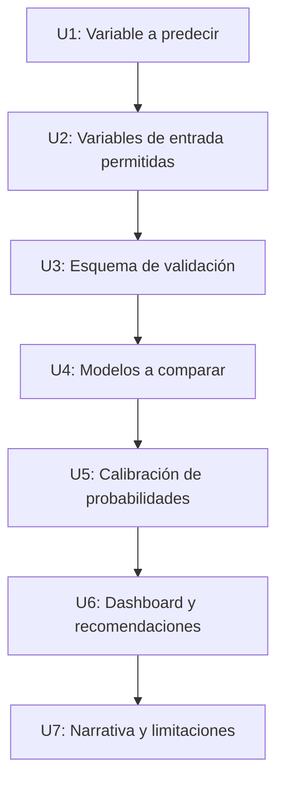

# Informe de decisión: caso universitario y caso producto

**Estado:** solo planificación. No se modificó ningún archivo del proyecto. Para fundamentar el informe corrí dos experimentos de solo lectura (`scratch/baseline_check.py` y `scratch/ablation_check.py`, en la carpeta de artefactos). Sus resultados están en la sección 1.

> [!IMPORTANT]
> Corrijo dos cosas que dije antes. Estimé una accuracy de 45–55 %; lo medido es **60–62 %**. Pero ese número engaña, porque una regla simple ("mediana por tribunal y tipo de audiencia") ya llega a **55,6 %**. La mejora real del modelo es de unos 6 puntos, no de 15.

---

## 1. Realidad actual

### 1.1 Qué tienen hoy

| Activo | Estado |
|---|---|
| Dataset preparado | 466.178 audiencias, 36 columnas, 0 nulos, 15 tribunales, 280.795 causas, 2015–2025 |
| ETL y auditoría | Completos, documentados y ya corregidos (informe anterior) |
| App Streamlit | 5 páginas: ingesta, ETL, informe, dashboard BI y EDA |
| Variable objetivo candidata | `PLAZO_AGENDAMIENTO` y `TRAMO_AGENDAMIENTO` (ya existe) |
| Modelo predictivo | **No existe** |
| Datos propios de un estudio (RIT, etapa, cliente) | **No existen** |
| Librerías | `scikit-learn` instalado; **falta agregarlo a `requirements.txt`** |

### 1.2 Resultado del experimento: ¿qué tan predecible es la espera?

**Diseño:** entrené con audiencias 2015–2023 (377.357 filas) y probé con 2024–2025 (88.821 filas), así simula el uso real. Target en 3 clases elegidas por mí: **Rápido** (≤ 15 días), **Estándar** (16–30) y **Demora** (> 30). Cada cifra es **una sola corrida**, sin ajuste de hiperparámetros.

**Líneas base (reglas sin modelo)**

| Regla | Accuracy | F1 macro |
|---|:---:|:---:|
| Siempre "Demora" (clase mayoritaria) | 48,0 % | 0,216 |
| Moda por tribunal | 50,8 % | 0,401 |
| Moda por tribunal × tipo de audiencia | **55,6 %** | **0,423** |

**Modelo (HistGradientBoosting) según las variables que se le dan**

| Variables de entrada | Accuracy | F1 macro | Log-loss | Severa > 60 d (PR-AUC) |
|---|:---:|:---:|:---:|:---:|
| A. Tribunal, procedimiento, tipo de audiencia, materia | **61,9 %** | 0,533 | 0,864 | 0,465 |
| B. A + modalidad | 61,9 % | 0,536 | 0,861 | 0,417 |
| C. B + mes y día de la semana de **programación** | 60,2 % | 0,523 | 0,868 | 0,421 |
| D. C + n.º de audiencia previa en la causa | 60,6 % | 0,525 | 0,861 | 0,419 |
| E. D + año (referencia) | 56,7 % | 0,480 | 0,985 | 0,446 |
| F. Con mes y día de la **audiencia** (no disponible al planificar) | 61,1 % | 0,528 | 0,857 | 0,423 |
| G. D, entrenado solo con 2021–2023 | 62,2 % | 0,502 | 0,855 | n/a |

**Lo que dicen estos números**

1. **Casi todo el poder predictivo está en 4 variables:** tribunal, procedimiento, tipo de audiencia y materia (A). Agregar modalidad, calendario o historial de la causa no mejora de forma demostrable. Las diferencias entre A–D (±1–2 puntos) caen dentro del ruido de una sola corrida.
2. **No encontré fuga relevante por el calendario.** La variante F (mes y día de la audiencia) rinde igual que D. Aun así, para el producto hay que usar fechas de programación, que es lo que el abogado conoce.
3. **El modelo gana unos 6 puntos de accuracy y 0,11 de F1 macro sobre la regla simple B3.** Es una mejora real y honesta, pero modesta.
4. **El año como variable empeora el modelo** (E: 56,7 %). Extrapolar la tendencia 2015–2022 hacia adelante falla porque el sistema no sigue una tendencia lineal (ver 1.3).
5. **Detectar espera severa (> 60 días) funciona razonablemente:** ROC-AUC ≈ 0,80 y PR-AUC ≈ 0,42–0,47 contra 0,18 de un clasificador al azar (prevalencia en test). Es una mejora de unas 2,5 veces sobre el azar.

### 1.3 El hallazgo más importante: el sistema cambió de régimen

| Año | 2015 | 2016 | 2017 | 2018 | 2019 | 2020 | 2021 | 2022 | 2023 | 2024 | 2025 |
|---|:---:|:---:|:---:|:---:|:---:|:---:|:---:|:---:|:---:|:---:|:---:|
| % audiencias con espera > 60 días | 1,5 | 2,4 | 3,1 | 4,3 | 4,8 | 7,3 | 16,8 | **29,2** | 20,6 | 20,3 | 15,9 |
| % clase "Demora" (> 30 días) | 21,5 | 24,2 | 31,3 | 34,2 | 36,4 | 42,3 | 55,8 | **63,8** | 58,1 | 47,7 | 48,3 |

Consecuencias directas:

- **Las probabilidades salen mal calibradas.** El modelo entrenado hasta 2023 subestima la demora en 2024–25:

| Probabilidad de Demora predicha | Frecuencia real observada |
|:---:|:---:|
| 0,22 | 0,31 |
| 0,41 | 0,56 |
| 0,59 | 0,71 |
| 0,81 | 0,80 |

  Un dashboard que muestre "41 % de probabilidad de demora" cuando la realidad fue 56 % **le miente al abogado** de forma sistemática. Hay que recalibrar con datos recientes.
- **Entrenar solo con el régimen reciente (2021–2023) mejora el log-loss** (0,855, el mejor de todos), aunque baja el F1 macro.
- **Para un producto, esto implica reentrenar y recalibrar de forma periódica.** Un modelo estático se vuelve optimista o pesimista en pocos meses.

### 1.4 El rango empírico rinde casi tanto como el modelo para el abogado

Un rango P25–P75 por tribunal × tipo de audiencia, calculado con 2021–2023, **cubre el 52,2 % de las audiencias reales de 2024–25** (ideal: 50 %). Calculado con todo 2015–2023 cubre 47,4 %. El ancho mediano es de 27–28 días, es decir, bastante ancho: la espera tiene mucha variabilidad que el modelo no explica.

Esto sugiere que **el núcleo del producto puede ser un estimador de rango bien calibrado**, y que el modelo de clasificación añade probabilidades y un indicador de riesgo.

### 1.5 Tamaño real del cubo

| Granularidad | Celdas | Celdas con n ≥ 30 |
|---|:---:|:---:|
| Tribunal × tipo de audiencia | 139 | 95 (68 %) |
| Tribunal × tipo × año × modalidad | 1.570 | 893 (57 %) |

Un cubo con 4 dimensiones tiene muchas celdas ralas (mediana de 56 audiencias por celda). Necesita una **regla de respaldo**: si la celda tiene pocos datos, se sube de nivel (por ejemplo, de tribunal × tipo a solo tipo) y se avisa al usuario.

### 1.6 Límites que conviene declarar siempre

- **Solo audiencias realizadas:** las suspendidas no aparecen (0,2 % marcadas como frustradas), así que el riesgo de reprogramación está subestimado.
- **Sin resultados de la causa** (sentencia, acuerdo, monto): no se puede estimar el resultado del juicio.
- **Una sola jurisdicción y una sola materia** (Familia, C.A. Valparaíso).
- **`ES_CONTINUACION` es prácticamente una función del tipo de audiencia** (6 % de prevalencia). Predecirla desde esas variables es casi trivial. Si quieren modelar continuaciones, el objetivo tiene que ser a nivel de **causa**, y eso no lo he probado.
- **Mis resultados vienen de una partición temporal y una corrida.** Para la entrega falta repetir con varias semillas y agregar intervalos de confianza.

---

## 2. Caso universitario

**Objetivo:** cumplir lo que pidió el profesor, "modelos predictivos de clasificación o dashboard con probabilidades y recomendaciones para abogados", con rigor defendible.

### U1. Variable a predecir

| Opción | Descripción | Pros | Contras |
|---|---|---|---|
| **A (recomendada)** | Tramo de espera en 3 clases (Rápido ≤ 15 d, Estándar 16–30 d, Demora > 30 d) | Responde "¿cuánto esperaré?" con probabilidades; fácil de explicar | Los cortes son una decisión suya; hay que justificarlos |
| B | Espera severa (> 60 d), binaria | Es una alerta clara de riesgo; ROC-AUC ≈ 0,80 | Prevalencia cambia mucho por año (1,5 % a 29 %) |
| C | Ambas: A como modelo principal y B como alerta | Cubre "clasificación" y "recomendaciones" | Más trabajo; dos métricas que explicar |
| D | Continuación del juicio | Útil para tarificar | Casi trivial con las variables disponibles; requiere rediseño a nivel de causa |

**Recomendación:** C si hay 2+ semanas; A si hay menos.

**Pasos:**
1. Justificar los cortes de A con la ley (plazos de la Ley 19.968) o con cuantiles, y dejarlo escrito.
2. Fijar el objetivo y no cambiarlo después de ver resultados.
3. Documentar la prevalencia de cada clase por año (tabla de 1.3).

### U2. Variables de entrada permitidas

| Opción | Variables | Resultado medido |
|---|---|---|
| **A (recomendada)** | Tribunal, procedimiento, tipo de audiencia, materia | 61,9 % accuracy |
| B | A + modalidad + mes y día de programación | 60,2–61,9 % |
| C | B + historial de la causa | 60,6 % |
| D | Incluir el año | **56,7 % (empeora)** |

**Recomendación:** A como modelo base, B como variante para mostrar que no mejora. Excluir siempre `DIAS_TRAMITACION_PREVIA`, `DIAS_DESPACHO_AGENDAMIENTO` (fuga ya detectada), duración y frustrada.

**Pasos:**
1. Escribir una tabla "qué sabe el abogado al decidir" y "qué no sabe". Es un punto fuerte de rigor para la presentación.
2. Usar fechas de programación, no de la audiencia.
3. Reportar el experimento de ablación como resultado, no solo el mejor modelo.

### U3. Esquema de validación

| Opción | Descripción | Veredicto |
|---|---|---|
| **A (recomendada)** | Entrenar con 2015–2023, probar con 2024–2025 | Simula el uso real; ya medido |
| B | Validación cruzada aleatoria | **No usar**: filas de una misma causa filtran información |
| C | Validación por bloques temporales (rolling origin) | Más robusta; permite ver la deriva |
| D | `GroupKFold` por `ID_CAUSA_RIT` dentro del entrenamiento | Complemento de A para ajustar hiperparámetros |

**Recomendación:** A + D. Si hay tiempo, C para mostrar el efecto de la deriva.

**Pasos:**
1. Fijar la partición por fecha de audiencia antes de mirar resultados.
2. Evitar que una misma causa aparezca en entrenamiento y prueba cuando sea posible.
3. Repetir con 5 semillas y reportar media y desviación.

### U4. Modelos a comparar

| Nivel | Modelo | Rol |
|---|---|---|
| Línea base | Mayoritaria, moda por tribunal, moda por tribunal × tipo | Piso obligatorio; ya medido |
| Interpretable | Regresión logística multinomial | Explica el efecto de cada factor |
| Árbol | Árbol de decisión acotado | Reglas legibles para abogados |
| Potente | HistGradientBoosting o Random Forest | Techo de rendimiento |

**Recomendación:** línea base + logística + HistGradientBoosting. `scikit-learn` ya está instalado.

**Pasos:**
1. Comparar siempre contra la línea base B3 (55,6 %).
2. Métricas: accuracy, **F1 macro**, **log-loss** y matriz de confusión. Con clases desbalanceadas, la accuracy sola engaña.
3. Si no mejoran la línea base en más de 3 puntos, reportarlo honestamente: es un hallazgo válido.

### U5. Calibración de las probabilidades

Es la decisión más importante si el dashboard va a mostrar probabilidades (ver 1.3).

| Opción | Descripción | Veredicto |
|---|---|---|
| A | Mostrar la probabilidad cruda del modelo | **No recomendado**: mal calibrada |
| **B (recomendada)** | Recalibrar con datos recientes (por ejemplo, 2023 como conjunto de calibración) | Corrige la deriva |
| C | Mostrar rangos en vez de probabilidades puntuales | Más honesto con la incertidumbre |

**Recomendación:** B + gráfico de calibración por quintiles en el informe, y mostrar la probabilidad con un aviso de que se basa en el comportamiento reciente.

**Pasos:**
1. Separar un conjunto de calibración posterior al de entrenamiento.
2. Aplicar `CalibratedClassifierCV` (o regresión isotónica) y volver a medir la tabla de calibración de 1.3.
3. Incluir el gráfico de confiabilidad en el informe.

### U6. Dashboard y recomendaciones

| Opción | Contenido | Esfuerzo |
|---|---|---|
| **A (recomendada)** | Página 6 "Simulador": entradas (tribunal, tipo de audiencia, procedimiento, materia) y salidas (probabilidades por tramo, rango típico P25–P75, alerta de riesgo y recomendación en texto) | Medio |
| B | Solo gráficos de probabilidades | Bajo |
| C | A + comparador de tribunales y "qué pasa si" | Alto |

**Reglas de recomendación (ejemplos para validar con un abogado):**

| Condición | Recomendación al abogado |
|---|---|
| P(Demora) > 60 % | Informar al cliente un plazo de 2 meses o más; evaluar solicitar agilización |
| P(severa > 60 d) > 25 % | Marcar la causa como de riesgo; reservar holgura en el calendario |
| Tribunal con rango estrecho y P(Rápido) > 50 % | Planificar en el corto plazo y preparar documentación antes |

**Pasos:**
1. Definir los umbrales con base en las probabilidades **calibradas**, no en las crudas.
2. Mostrar siempre el N de la celda y un aviso cuando sea bajo.
3. Entrevistar a un abogado de familia para validar que las recomendaciones tengan sentido práctico.

### U7. Narrativa y limitaciones

**Recomendación:** presentar un resultado honesto con estas líneas:

- "El modelo mejora 6 puntos a una regla simple y detecta espera severa con ROC-AUC ≈ 0,80."
- "El sistema cambió de régimen: la calibración exige datos recientes."
- "Las variables disponibles al planificar explican poco; el valor está en las probabilidades y en el rango."
- Sección explícita de limitaciones (ver 1.6).

### Plan sugerido según el tiempo disponible

| Si tienen | Alcance recomendado |
|---|---|
| **1 semana** | U1-A, U2-A, U3-A, U4 (línea base, logística, HistGradientBoosting), U6-B, informe corto |
| **2 semanas** | Lo anterior + U5-B (calibración) + U6-A (simulador) + U1-B (alerta severa) |
| **3 semanas** | Lo anterior + U3-C (bloques temporales) + entrevista con abogado + presentación pulida |

**Criterios de aceptación:** (1) partición temporal documentada, (2) tres líneas base reportadas, (3) gráfico de calibración, (4) tabla de limitaciones, (5) simulador usable por alguien que no vio el código.

---

## 3. Caso producto

**Objetivo:** una herramienta donde el abogado ingresa campos clave y recibe un predictor para planificar y gestionar el estudio. Su idea de "cubo OLAP + predictor" es coherente con los datos, con tres ajustes que muestra la sección 1.

### P1. Qué problema resuelve primero

| Opción | Problema | Dato necesario | Disponible hoy |
|---|---|---|---|
| **A (recomendada)** | "¿Cuándo será mi audiencia?" (plazo y riesgo) | Datos públicos de audiencias | **Sí** |
| B | "¿Cómo reparto la carga del estudio?" (planificación de cartera) | Causas vigentes del estudio (RIT, etapa) | **No** |
| C | "¿Cuánto cobrar?" (pricing por riesgo de continuación) | Resultado y duración total de causas | **No** |

**Recomendación:** A como producto mínimo y B como siguiente módulo. C requiere datos que hoy no existen.

**Pasos:**
1. Redactar la propuesta de valor en una frase: "para cada causa, un rango de días y un nivel de riesgo, calibrados con datos recientes".
2. Entrevistar a 5–10 abogados antes de construir más (ver P7).

### P2. Diseño del cubo OLAP

| Opción | Tecnología | Pros | Contras |
|---|---|---|---|
| **A (recomendada para empezar)** | DuckDB (ya está en `requirements.txt`) sobre el parquet, con consultas por dimensiones | Rápido, sin servidor, SQL | Hay que escribir la lógica de rollup |
| B | Tablas pivote precalculadas en pandas | Muy simple | Poco flexible |
| C | Motor OLAP completo (por ejemplo ClickHouse o Cube.js) | Escala | Excesivo con 466 mil filas |

**Dimensiones:** tribunal, tipo de audiencia, tiempo (año, mes), modalidad, materia, época normativa. **Medidas:** N, mediana, P25, P75, % de demora y % de severa.

**Regla de respaldo obligatoria** (por la dispersión de 1.5): si la celda tiene menos de 30 audiencias, se sube de nivel y se muestra "estimación basada en N audiencias de un nivel superior".

**Pasos:**
1. Fijar la jerarquía de rollup (tribunal × tipo → tipo → global).
2. Definir el umbral mínimo de N y la forma de avisarlo al usuario.
3. Ponderar por recencia (ver P3).

### P3. Motor de predicción

| Opción | Descripción | Evidencia |
|---|---|---|
| **A (recomendada para v1)** | Rango empírico por celda del cubo, con ventana reciente (por ejemplo, últimos 24–36 meses) | Cubre 52 % con P25–P75 usando 2021–2023 |
| B | Clasificador calibrado (tramo y riesgo severo) sobre el rango | +6 puntos sobre la regla simple |
| C | Regresión cuantílica | Da rangos con mejor ajuste; no probada aún |

**Recomendación:** A en la v1. Agregar B cuando haya validación de usuarios y un esquema de recalibración periódica. Considerar C si el rango es demasiado ancho.

**Pasos:**
1. Definir la ventana de recencia con una prueba: ¿qué ventana maximiza la cobertura en un periodo posterior?
2. Reentrenar y recalibrar cada mes o trimestre.
3. Publicar siempre la cobertura histórica del rango ("este rango acertó en el 52 % de los casos recientes").

### P4. Datos del estudio y cumplimiento

| Opción | Descripción | Riesgo |
|---|---|---|
| **A (recomendada para v1)** | Sin datos del estudio: el abogado solo selecciona campos | Bajo |
| B | El abogado carga una lista de RIT para proyectar su cartera | Medio: datos de clientes y causas |
| C | Integrar con sistemas de gestión del estudio | Alto: dependencias comerciales |

**Pasos:**
1. Revisar los términos de uso de los datos estadísticos del PJUD para uso comercial.
2. Revisar la normativa de protección de datos personales (Ley 19.628 y su reforma) antes de manejar datos de clientes. **Esto debe validarlo un abogado**; no lo asumo.
3. Si hay carga de RIT, procesarla sin guardar datos identificables.

### P5. Actualización de datos y mantenimiento

| Opción | Descripción | Esfuerzo |
|---|---|---|
| A | Carga manual trimestral | Bajo |
| **B (recomendada)** | Script programado mensual vía API, con validaciones y registro de versión del modelo | Medio |
| C | Pipeline automatizado completo con monitoreo de deriva | Alto |

**Pasos:**
1. Reusar `Api_Caller` y el ETL como un script reproducible.
2. Guardar la fecha de corte y la versión del modelo en cada predicción mostrada.
3. Definir una alerta de deriva (por ejemplo, si la cobertura del rango cae por debajo de 40 % o sobre 60 %).

### P6. Cobertura geográfica y de materias

| Opción | Alcance | Mercado | Esfuerzo |
|---|---|---|---|
| A | Familia, Valparaíso (hoy) | Limitado | Ninguno |
| **B (recomendada)** | Familia nacional | Cerca de 7 veces más datos | Medio (descargar y adaptar el ETL) |
| C | Laboral, Civil y Penal | El mayor | Alto |

**Nota:** los JSON nacionales de Familia ya se descargaron una vez, siguen en el historial de git (commit `352dcd4`) y se pueden volver a bajar con `Api_Caller`.

**Pasos:**
1. Validar primero con Valparaíso (P1 a P3), antes de expandir.
2. Al expandir, volver a medir calibración **por región**: la deriva puede ser distinta.
3. Elegir la siguiente materia por demanda de los entrevistados.

### P7. Validación de mercado y modelo de negocio

| Opción | Descripción |
|---|---|
| **A (recomendada)** | Entrevistas y prototipo a 5–10 abogados de familia para medir si pagarían y cuánto |
| B | Piloto gratuito con 2–3 estudios y registro de uso |
| C | Licenciar el motor a un software legal existente (por ejemplo Lemontech CaseTracking), que ya tiene la base de clientes |

**Pasos:**
1. Preparar 5 preguntas: ¿hoy cómo estimas plazos?, ¿cuántas veces te equivocas?, ¿qué decisión cambiarías con un rango?, ¿cuánto pagarías?, ¿qué falta?
2. Mostrar el simulador con 3 casos reales y registrar reacciones.
3. Definir como puerta de decisión: si menos de 3 de 10 pagarían, replantear el segmento antes de invertir en infraestructura.

---

## 4. Hoja de ruta integrada con puertas de decisión

| Etapa | Contenido | Puerta de salida |
|---|---|---|
| **0. Decisiones** | Elegir en U1–U7 y P1–P7 | Equipo alineado en las recomendaciones o ajustes |
| **1. Entregable universitario** | Modelo, calibración, simulador, informe | Los 5 criterios de aceptación de la sección 2 |
| **2. Validación con usuarios** | Entrevistas y prototipo (P7) | Al menos 3 de 10 abogados dispuestos a pagar |
| **3. Producto v1** | Cubo con DuckDB, rango empírico reciente, actualización mensual (P2, P3, P5) | Cobertura del rango estable entre 40 y 60 % por 2 trimestres |
| **4. Expansión** | Familia nacional, módulo de cartera (P1-B, P6-B) | Calibración válida por región |
| **5. Escalamiento** | Otras materias, licencias o integraciones (P6-C, P7-C) | Casos de negocio por cada materia |

**Qué se reutiliza del caso universitario en el producto:** la partición temporal, las líneas base, el esquema de calibración, la tabla de variables permitidas y el simulador. Lo que **no** se reutiliza tal cual: el modelo entrenado, porque necesita reentrenamiento y recalibración continuos.

---

## 5. Decisiones que necesito de ustedes

Si aceptan las recomendaciones, basta con responder "acepto los valores recomendados". Si no, indiquen cuál cambiar.

| N.º | Decisión | Recomendación |
|---|---|---|
| U1 | Variable a predecir | C: tramo de 3 clases y alerta severa (A si hay poco tiempo) |
| U2 | Variables de entrada | A: tribunal, procedimiento, tipo y materia; mostrar ablación |
| U3 | Validación | A + D: partición temporal y agrupación por causa |
| U4 | Modelos | Líneas base + logística + HistGradientBoosting |
| U5 | Calibración | B: recalibrar con datos recientes |
| U6 | Dashboard | A: página "Simulador" con reglas de recomendación |
| U7 | Narrativa | Resultado honesto con limitaciones explícitas |
| P1 | Problema inicial del producto | A: "¿cuándo será mi audiencia?" |
| P2 | Cubo | A: DuckDB con regla de respaldo por N |
| P3 | Motor | A en la v1; B tras validar con usuarios |
| P4 | Datos del estudio | A en la v1; revisión legal antes de B |
| P5 | Actualización | B: script mensual con versión de modelo |
| P6 | Cobertura | A para validar, luego B |
| P7 | Mercado | A: entrevistas a 5–10 abogados |

**Dos preguntas que cambian el plan:**
1. ¿Cuál es la fecha de entrega y cuántas personas trabajan en esto?
2. ¿El profesor exige un tipo de modelo concreto, o basta con "clasificación" y "dashboard con probabilidades"?
