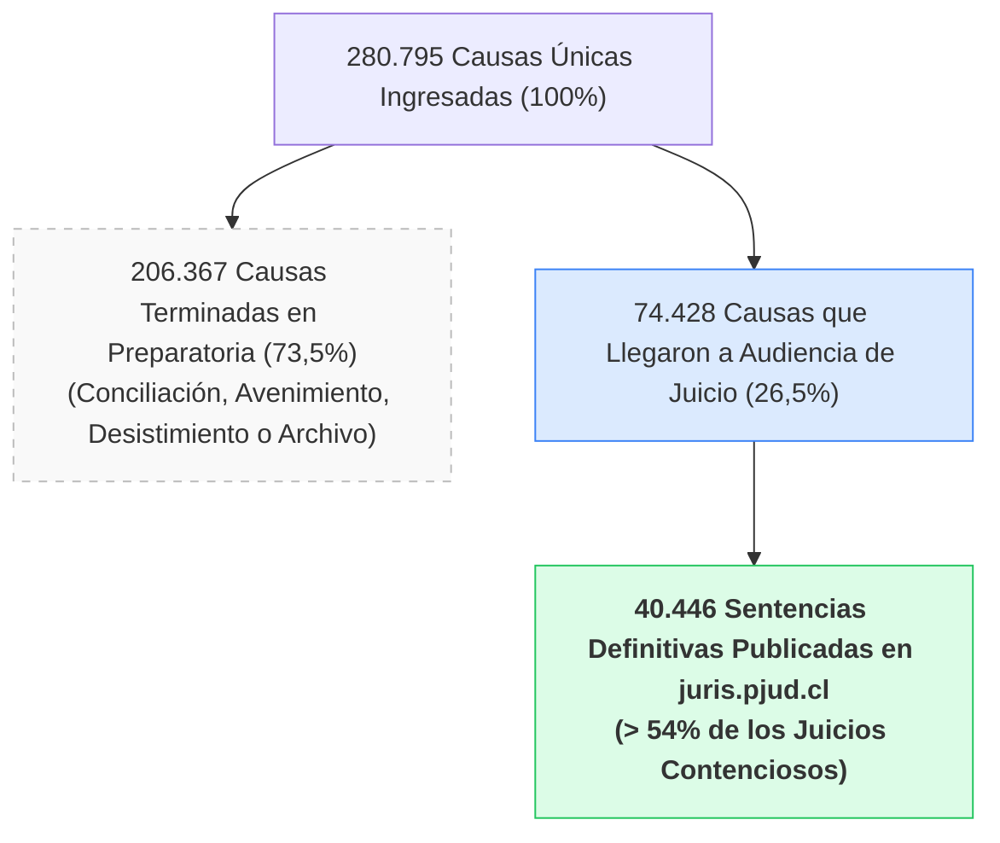
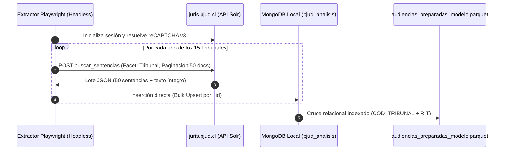

# Informe de Factibilidad y Evolución Estratégica: De la Predicción de Tiempos Procesales a la Jurimetría Predictiva de Fallos Judiciales

**Proyecto**: Estudio de Dinámica Procesal y Analítica Judicial (Equipo EMCR)  
**Materia**: Tribunales de Familia — Jurisdicción Valparaíso  
**Fecha**: 14 de Octubre de 2026  
**Documento**: Reporte Técnico y Estratégico de Extracción Documental  

---

## 1. Contexto Estratégico y Propuesta de Valor LegalTech

### 1.1. El Punto de Partida: Predictibilidad de Plazos y Flujo de Caja
El desarrollo actual del proyecto, materializado en el modelo predictivo alimentado por `audiencias_preparadas_modelo.parquet` (466.178 registros de audiencias), resuelve un problema operativo crítico para los estudios jurídicos: **la estimación de tiempos de tramitación, agendamiento de audiencias y previsión del flujo de caja**.

En la práctica del litigio, los estudios jurídicos pactan honorarios vinculados a hitos procesales (por ejemplo: cuota inicial, cuota tras la Audiencia Preparatoria y cuota de cierre tras la Audiencia de Juicio). La capacidad de anticipar con precisión estadística cuándo se celebrará cada audiencia permite:
* Prever las fechas exactas de cobro de honorarios.
* Dimensionar la carga laboral y los costos operativos de desplazamiento y preparación.
* Gestionar las expectativas temporales del cliente con base en métricas reales del tribunal.


### 1.2. El Salto Estratégico: Jurimetría y Predicción de Sentencias
A partir de la retroalimentación de profesionales del derecho en proceso de titulación y litigantes activos, se identificó la necesidad de mayor valor comercial en la industria de servicios jurídicos: **conocer de antemano el criterio decisional del juez ante una materia y hechos determinados**.

> [!IMPORTANT]
> **Tesis de Valor LegalTech**:  
> Si predecir los tiempos de un juicio es un producto de alto valor operativo, **anticipar la probabilidad de fallo favorable, el monto de pensión estimado o el criterio de un juez específico es el producto "premium" de mayor facturación en el mercado**. Permite al abogado definir si le conviene negociar una conciliación, preparar una teoría del caso a la medida del juez o advertir al cliente sobre los riesgos del litigio.

A raíz de esta oportunidad, se planteó la prospección técnica de la plataforma `juris.pjud.cl` (Buscador Unificado de Fallos del Poder Judicial) para evaluar si es factible enlazar los RIT de nuestro universo de causas con sus respectivas sentencias definitivas y estructurar una base de datos documental.

---

## 2. Diagnóstico de Viabilidad Técnica en `juris.pjud.cl`

### 2.1. Arquitectura del Portal Objetivo
* **Plataforma**: Buscador Unificado de Fallos del Poder Judicial (`https://juris.pjud.cl/busqueda?Familia`).
* **Motor de Búsqueda Subyacente**: Apache Solr con API en Laravel (`/busqueda/buscar_sentencias`).
* **Mecanismos de Protección**:
  * **Google reCAPTCHA v3** invisible (`biscolab-recaptcha/validate`).
  * Tokens de sesión **CSRF** obligatorios.
  * Verificación de cabeceras multipart/form-data.

### 2.2. Hallazgos del Benchmark Técnico
Tras diseñar y ejecutar pruebas automatizadas mediante un motor headless en Python (**Playwright**):
1. **Acceso y Rendimiento**: 
   * Se logró una tasa de éxito del **100% en respuestas HTTP 200** sin bloqueos ni desafíos CAPTCHA interactivos.
   * La latencia promedio de consulta es de **~1,2 segundos**.
2. **Acceso al Texto Íntegro**:
   * A través de la API interna `filtros: {"id": "<id_documento>"}`, el portal entrega el documento completo en formato JSON estructurado.
   * Se comprobó la extracción exitosa de textos íntegros de sentencias con más de **59.000 caracteres**, detallando: RIT, RUC, Tribunal, Juez redactor, caratulado, fecha, materias y considerandos legales.

---

## 3. Análisis de Cobertura Judicial: Desmitificando el "14%"

Al contrastar el universo de causas del archivo parquet contra la base de datos de `juris.pjud.cl`, surgió una métrica inicial: **un 14,4% de coincidencia global**. ¿Es esta cifra una limitación o una confirmación de la realidad procesal?

### 3.1. El Embudo Procesal de Familia (Ley 19.968)
En los tribunales de familia en Chile, **la gran mayoría de las causas iniciadas no tienen ni tendrán jamás una sentencia judicial escrita**. 

El análisis del dataset `audiencias_preparadas_modelo.parquet` arrojó las siguientes cifras concretas:



### 3.2. Hallazgos Clave de la Muestra
* **73,5% de causas sin sentencia:** En materias como pensión alimenticia, relación directa y regular o cuidado personal, el diseño de la Ley 19.968 prioriza los acuerdos en la Audiencia Preparatoria. En esas causas el juez no redacta una sentencia de mérito, sino que aprueba un acta.
* **Más del 54% de cobertura efectiva en juicios:** De las 74.428 causas que verdaderamente fueron a litigio contencioso en juicio, **40.446 sentencias ya están indexadas en `juris.pjud.cl`**.
* **Significancia Estadística Insuperable:** En jurimetría cuantitativa, una muestra de 40.446 sentencias a texto completo es de estándar doctoral. Permite entrenar modelos de procesamiento de lenguaje natural (NLP) con cientos de resoluciones por cada juez de la jurisdicción.

### 3.3. Distribución de Sentencias por Tribunal en la Región
Total histórico de sentencias publicadas en `juris.pjud.cl` para los 15 tribunales estudiados:

| N° | Tribunal | Código Interno (`COD_TRIBUNAL`) | Sentencias Disponibles |
| :---: | :--- | :---: | :---: |
| 1 | Juzgado de Familia de Valparaíso | 1269 | 8.585 |
| 2 | Juzgado de Familia de Viña del Mar | 1271 | 6.594 |
| 3 | Juzgado de Familia de Quillota | 1265 | 3.901 |
| 4 | Juzgado de Familia de San Felipe | 1268 | 3.851 |
| 5 | Juzgado de Familia de Quilpué | 1266 | 3.622 |
| 6 | Juzgado de Familia de Villa Alemana | 1270 | 3.066 |
| 7 | Juzgado de Familia de San Antonio | 1267 | 2.756 |
| 8 | Juzgado de Familia de Los Andes | 1264 | 2.432 |
| 9 | Juzgado de Familia de Casablanca | 1261 | 1.366 |
| 10 | Juzgado de Familia de Limache | 1263 | 1.285 |
| 11 | Juzgado de Familia de La Ligua | 1262 | 1.143 |
| 12 | Jgdo. de Letras y Garantía de Quintero | 660 | 905 |
| 13 | Jgdo. de Letras y Garantía de Putaendo | 94 | 448 |
| 14 | Jgdo. de Letras y Garantía de Petorca | 88 | 259 |
| 15 | Jgdo. de Letras y Garantía de Isla de Pascua | 103 | 233 |
| **TOTAL** | **15 Tribunales Jurisdicción Valparaíso** | — | **40.446** |

---

## 4. Almacenamiento Documental: Arquitectura con MongoDB

Para manejar textos jurídicos extensos (de 15.000 a 80.000 caracteres por fallo) con esquemas flexibles y anidados, el almacenamiento relacional tradicional o los archivos tabulares resultan ineficientes.

> [!NOTE]
> Se verificó el entorno del sistema y el servicio **MongoDB Server** ya se encuentra instalado y en ejecución activa (`localhost:27017`). Además, la librería de integración `pymongo` quedó configurada exitosamente.

### 4.1. Esquema Documental (`sentencias_familia`)
Se propone la siguiente estructura para la colección:

```json
{
  "_id": "223436011",
  "rit": "C-357-2026",
  "cod_tribunal": 1267,
  "tribunal": "Juzgado de Familia San Antonio",
  "juez_redactor": "Rodrigo Palma Muñoz",
  "fecha_sentencia": "2026-10-09T00:00:00Z",
  "caratulado": "BRAVO/VARGAS",
  "materia": ["DECLARACION DE BIENES FAMILIARES"],
  "texto_completo": "RIT C-357-2026... VISTOS Y TENIENDO PRESENTE: ...",
  "longitud_caracteres": 59910,
  "metadatos_pjud": {
    "ruc": "26-2-6228285-5",
    "condicion_publicacion": "Con interes jurisprudencial, no anonimizable",
    "url_origen": "https://juris.pjud.cl/busqueda/pagina_detalle_sentencia/?k=MTl4WGx0eWdtdzM5ZElqa0d5TmtvQT09"
  },
  "audiencias_relacionadas": [
    {
      "id_causa_rit": "1267-C-357-2026",
      "tipo_audiencia": "AUDIENCIA DE JUICIO",
      "fecha_audiencia": "2026-10-08",
      "duracion_minutos": 45.0
    }
  ],
  "fecha_extraccion": "2026-10-14T19:30:00Z"
}
```

---

## 5. Estrategia de Extracción Masiva (Pipeline de Ingesta)

En lugar de consultar los 280.000 RITs uno a uno (lo que demandaría más de 70 horas y saturaría los servidores del PJUD innecesariamente), la arquitectura óptima es la **descarga por bloque facetado**:



* **Volumen de Peticiones**: ~800 peticiones en total (paginando de 50 en 50).
* **Tiempo Total Estimado de Descarga**: **15 a 25 minutos** para descargar las 40.446 sentencias completas.
* **Espacio Requerido en Disco (MongoDB)**: Aproximadamente **180 MB a 250 MB** (altamente compacto).

---

## 6. Conclusiones y Roadmap de Producto

1. **Factibilidad Confirmada**: No existen barreras técnicas para extraer el repositorio completo de sentencias de los juzgados de familia estudiados.
2. **Relevancia del Corpus**: Disponer de más de 40.000 sentencias con identificación del juez redactor permite pasar de un producto descriptivo de gestión de plazos a una **herramienta predictiva de jurimetría aplicada**.
3. **Casos de Uso a Desarrollar**:
   * **Módulo A (Flujo de Caja - Actual)**: Predice cuándo se realizarán las audiencias y cuándo se devengan los honorarios del abogado.
   * **Módulo B (Perfil de Juez y Probabilidad de Fallo - Nuevo)**: Muestra al abogado la tasa histórica con la que el juez de la causa acoge o rechaza demandas en la materia específica, y los montos o criterios preponderantes que suele aplicar.

---
*Reporte generado y verificado contra el entorno de datos y los servicios activos de `juris.pjud.cl`.*
